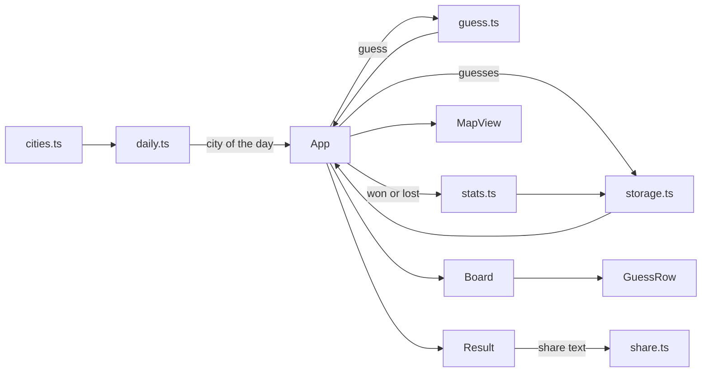

# وين؟: the architecture

Decided 23 Oct 2026, at the Architecture stage. The UI stage is skipped: the screens are small, and they're described here.

## The parts

**Data**
- `src/data/cities.ts`: the city list (the only content in the game).
- `src/data/outline.ts`: the country's outline as one SVG path string on a fixed box (`viewBox 0 0 1000 816`, longitude 34.0–56.5, latitude 15.5–32.5), plus `project(lat, lon)` that maps a point onto it.

**Game logic (pure, tested)**
- `src/game/geo.ts`: `distanceKm(a, b)`, `bearing(a, b)`, `arrow(bearing)`, `closeness(km)`.
- `src/game/daily.ts`: `puzzleNumber(now)`, `cityOfDay(n)`, `randomCity(exclude)`; the seeded shuffle lives here.
- `src/game/guess.ts`: `evaluate(guess, target) → { city, km, arrow, closeness }`; `state(guesses, target) → 'playing' | 'won' | 'lost'`.
- `src/game/share.ts`: `shareText({ n, guesses, won, lang })`.
- `src/game/stats.ts`: `recordResult(stats, won, guessCount)`, `emptyStats()`.
- `src/game/storage.ts`: load and save of `wein:today`, `wein:stats`, `wein:lang`, each guarded with try/catch.

**UI (React)**
- `src/App.tsx`: the language, the mode (daily or practice), the current game; wires the pieces below.
- `src/ui/Header.tsx`: the title, the puzzle number, buttons for stats, help and language.
- `src/ui/GuessInput.tsx`: a text box with a filtered list of cities (matches Arabic or English, ignoring hamza and taa marbuta differences), keyboard friendly.
- `src/ui/GuessRow.tsx`: one guess: name, km, arrow, closeness, and the five squares.
- `src/ui/Board.tsx`: the six rows and the hint line (region from the third guess).
- `src/ui/Result.tsx`: the win or loss message, the answer, the share button, the countdown to the next puzzle, the practice button.
- `src/ui/MapView.tsx`: the outline with the guesses as dots coloured by closeness, and the answer once the game is over.
- `src/ui/StatsDialog.tsx`, `src/ui/HelpDialog.tsx`.
- `src/i18n.ts`: every string, in `ar` and `en`, and `t(key)`.

## How data flows

1. On load, `App` reads the language and today's saved game. If the saved puzzle number isn't today's, it starts fresh.
2. A guess goes through `evaluate`; the new list of guesses is saved and rendered.
3. On the sixth guess or a hit, the state becomes won or lost, stats are recorded once, and `Result` appears.
4. Practice mode uses the same components with a random city and no storage or stats.

## The screens

One page, phone width, centred, max 480 px wide on a laptop.

1. **Play:** header; the board (six rows, empty rows drawn as faint slots); the input under the board with its suggestions list above the keyboard; the map under the board, small.
2. **Done:** the board as it ended, the result card over the input: the message, the answer (with its region), Share, the countdown "next puzzle in 7h 12m", and Practice.
3. **Stats:** a dialog: played, win %, current streak, best streak, and six bars.
4. **Help:** a dialog with three lines and one example row.

Colours: paper background, ink text, one green for hits and squares, one amber for partial, grey for far. Dark mode follows the system through Chakra's colour mode.

## Rules the code keeps

- All game logic is pure functions in `src/game/` with Vitest tests; components only render and call them.
- The city list is the only place city facts live. No city names in the UI code.
- Every string shown to a person goes through `i18n.ts`.
- `localStorage` reads and writes are wrapped: the game works with storage blocked, it just forgets.
- Dates use `Asia/Riyadh`, never the device's zone, so the puzzle changes at the same moment for everyone.
- No network calls at runtime: the page is complete in `dist/`.
